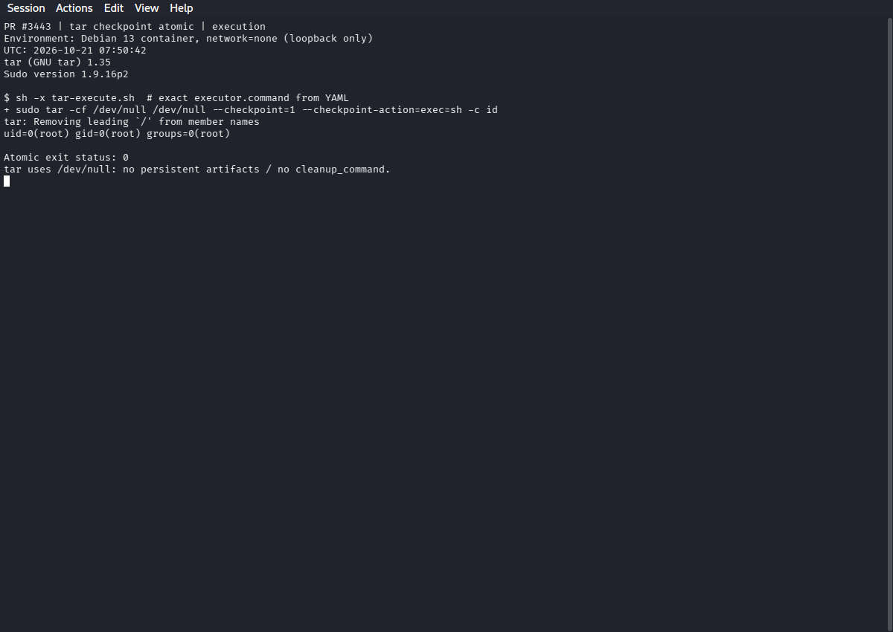
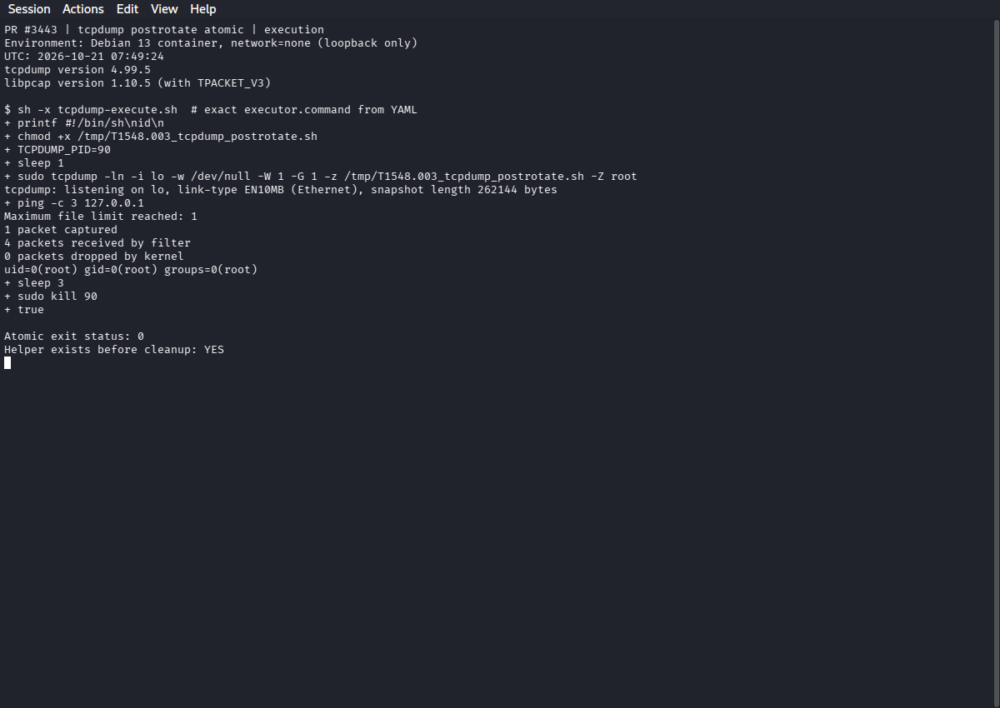
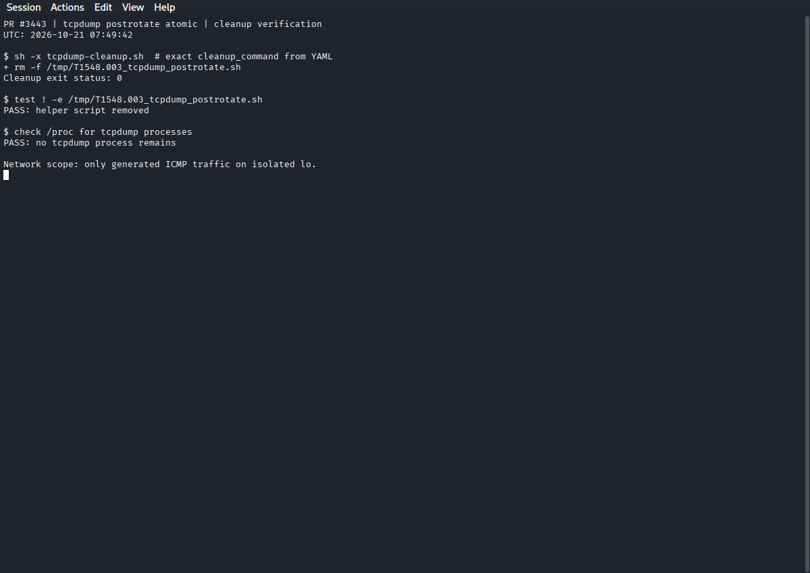

# Execution evidence for Atomic Red Team PR #3443

Source PR: https://github.com/redcanaryco/atomic-red-team/pull/3443

Tested revision: `414a7aea90160100ab3aed2cffc8379a11230db9`.

Environment: Debian 13 Docker container; network mode `none` (isolated loopback).
GNU tar 1.35, tcpdump 4.99.5, libpcap 1.10.5, sudo 1.9.16p2.
The container ran as root, matching the tests' `elevation_required: true`.
No host sudoers settings were changed. Only generated loopback ICMP traffic was captured.

The executor and cleanup shell blocks were extracted from the YAML and executed
with `sh -x` directly; this was not an Invoke-AtomicTest/PowerShell harness run.
The attached PNGs are captures of the actual QTerminal window during execution.

- tar checkpoint: hook printed `uid=0(root)`; execution exit status 0.
  The command uses `/dev/null` and has no persistent artifacts or cleanup command.
- tcpdump postrotate: helper printed `uid=0(root)`; execution exit status 0.
  The helper existed before cleanup.
- tcpdump cleanup: exit status 0; helper removed; no tcpdump process remains.

The final tcpdump stop is best-effort because `-W 1` can finish the process
naturally before `kill` executes. The updated YAML uses `|| true` on that final
stop only. This avoids treating successful natural completion as an atomic failure.

Validation: official `Validator` passed for the T1548.003 directory. The repository's
`atomic_red_team/tests` suite passed: 16 tests. This is targeted validation of the
changed technique and validator/model tests, not a full sparse-excluded repository scan.

## Screenshots

